# Comprehensive Workflow & Architecture Guide
## Swin-EVDNet v2 3D: Brain Tumor Segmentation & Evidential Uncertainty Profiling

---

## 1. Executive Summary

This project implements an end-to-end, clinically oriented deep learning pipeline for **3D Brain Tumor Segmentation** and **Patient-Level Tumor Burden Classification** with built-in **Epistemic Uncertainty Quantification**. 

Built upon the **BraTS 2023 (Brain Tumor Segmentation) Adult Glioma** challenge paradigm, the system takes four standardized multi-parametric Magnetic Resonance Imaging (mpMRI) modalities:
1. **T1**: Native T1-weighted anatomical sequence
2. **T1ce**: T1-weighted contrast-enhanced sequence (Gadolinium contrast)
3. **T2**: T2-weighted sequence highlighting edema and fluid
4. **FLAIR**: T2 Fluid-Attenuated Inversion Recovery sequence

Rather than treating the neural network as a black-box that produces overconfident probability predictions, this model employs **Evidential Deep Learning (EDL)** rooted in Subjective Logic and Dirichlet distributions. It explicitly disentangles **aleatoric uncertainty** (data noise/sensor artifacts) from **epistemic uncertainty** (model ignorance / lack of evidence), providing clinicians and researchers with a trustworthy assessment of both tumor boundaries and model reliability.

---

## 2. System Architecture & Directory Structure

```
ML MODEL/
│
├── brain-tumor-app/                  # Main standalone production application
│   ├── app.py                       # Modern Gradio web application & inference engine
│   ├── model.py                     # SwinEVDNet3D model architecture definition
│   ├── preprocess.py                # NIfTI loading, resampling, and normalization
│   ├── requirements.txt             # Deployment dependency manifest
│   ├── Dockerfile                   # Containerization manifest for production/Spaces
│   ├── README.md                    # Repository & Hugging Face card
│   ├── run_gradio.sh                # Local Gradio launcher script
│   └── run_local_api.sh             # Alternative local FastAPI launcher script
│
├── inputs/                          # Lightweight inference assets & evaluation artifacts
│   ├── best_slim.pt                 # Slim model state_dict (24.3 MB, identical weights)
│   ├── burden_thresholds.json       # Clinical volume tertiles [64.90 mL, 121.13 mL]
│   ├── FINDINGS.md                  # Detailed training analysis & notebook reverse-engineering
│   ├── hf_deploy.py                 # Automated Hugging Face Space deployer script
│   └── sample_case/                 # Test sample NIfTI volumes for local validation
│
├── results (1)/                     # Original training artifact cache (~760 MB)
│   ├── app.py                       # Historical FastAPI prototype from Kaggle run
│   ├── DEPLOYMENT_GUIDE.md          # Original raw deployment instructions
│   └── swin-evdnet-v2-3d/           # Training logs, data splits, and raw checkpoints
│       └── run/checkpoints/best.pt  # Full training checkpoint (model + optimizer + config)
│
└── WORKFLOW.md                      # This comprehensive architecture and workflow guide
```

---

## 3. High-Level Pipeline Workflow

The complete end-to-end pipeline operates in five synchronized phases:

```mermaid
flowchart TD
    subgraph Phase1["1. Multi-Modal Ingestion"]
        A1["T1 (.nii/.gz)"]
        A2["T1ce (.nii/.gz)"]
        A3["T2 (.nii/.gz)"]
        A4["FLAIR (.nii/.gz)"]
    end

    subgraph Phase2["2. Preprocessing & Alignment (preprocess.py)"]
        B1["Drop Singleton Trailing Dims (_as_3d)"]
        B2["Reference Grid Check & Trilinear Resampling"]
        B3["Non-Zero Voxel Z-Score Normalization"]
        B4["Channel Concatenation -> (1, 4, D, H, W)"]
    end

    subgraph Phase3["3. Sliding-Window Inference (app.py)"]
        C1["3D Gaussian Weighting Matrix (96x96x96)"]
        C2["50% Overlap Patch Generation"]
        C3["Batch Forward Pass through SwinEVDNet3D"]
        C4["Dirichlet Alpha Accumulation"]
    end

    subgraph Phase4["4. Dual-Head Model Execution (model.py)"]
        D1["3D Swin Transformer Hierarchical Encoder"]
        D2["3D ASPP Bottleneck"]
        D3["Multi-scale Residual Decoder"]
        D4["EvidentialSegHead3D -> seg_alpha (Voxel Dirichlet)"]
        D5["Whole-Brain Pooling -> EvidentialClsHead -> cls_alpha"]
    end

    subgraph Phase5["5. Metrics, Visualization & UI (app.py)"]
        E1["Tumor Probability (p = alpha_1 / S)"]
        E2["Epistemic Uncertainty (u = 2 / S)"]
        E3["Thresholding & Physical Volume (mL) Calculation"]
        E4["Burden Classification (Low / Med / High)"]
        E5["Matplotlib 3-Panel Slice Generator"]
        E6["Interactive Gradio Dashboard UI"]
    end

    Phase1 --> Phase2
    Phase2 --> Phase3
    Phase3 --> Phase4
    Phase4 --> Phase5
```



---

## 4. Preprocessing & Data Ingestion Deep-Dive

Raw clinical MRI scans vary significantly across scanner vendors, acquisition protocols, field strengths (1.5T vs 3.0T), and patient orientations. Preprocessing in `preprocess.py` standardizes the scans into an analytical tensor:

### 4.1 Strict 3D Verification (`_as_3d`)
Some clinical export tools save 3D acquisitions with trailing 4D time/singleton dimensions (e.g. `(240, 240, 155, 1)`).
- The pipeline checks if `len(shape) > 3`.
- Any trailing dimension equal to 1 is dropped via slice indexing: `image.dataobj[..., 0]`.
- Non-singleton 4D volumes raise an explicit error.

### 4.2 Spatial Alignment & Grid Matching (`_same_grid`)
All four modalities must inhabit the exact same spatial grid and coordinate system.
- The **T1 scan** serves as the fixed spatial anatomical reference.
- For each subsequent modality (`T1ce`, `T2`, `FLAIR`), the affine matrix and spatial dimensions are compared against the reference.
- If dimensions or affine transformations differ (tolerance $> 10^{-4}$), the modality is resampled to the reference grid using first-order trilinear interpolation (`nibabel.processing.resample_from_to`) with constant background padding ($0.0$).

### 4.3 Non-Zero Voxel Z-Score Normalization (`zscore_nonzero`)
MRI pixel intensities do not have standard physical units (unlike CT Hounsfield Units). Applying global z-score normalization would bias the statistics heavily toward the empty air background.
1. A boolean mask of non-zero, finite brain voxels is identified:
   $$\mathcal{M} = \{v \in V \mid v \neq 0 \land \text{isfinite}(v)\}$$
2. The mean ($\mu$) and standard deviation ($\sigma$) are calculated strictly over $\mathcal{M}$:
   $$\mu = \frac{1}{|\mathcal{M}|} \sum_{i \in \mathcal{M}} v_i, \quad \sigma = \sqrt{\frac{1}{|\mathcal{M}|} \sum_{i \in \mathcal{M}} (v_i - \mu)^2}$$
3. Voxels inside the brain mask are normalized; background air remains zero:
   $$v'_i = \begin{cases} \frac{v_i - \mu}{\sigma}, & i \in \mathcal{M} \\ 0.0, & i \notin \mathcal{M} \end{cases}$$
4. If a channel contains fewer than 10 non-zero voxels or has near-zero variance ($\sigma < 10^{-6}$), it is safely zero-padded to prevent division by zero.

### 4.4 Tensor Assembly
The 4 normalized channels are stacked along the channel axis:
$$\mathbf{X} \in \mathbb{R}^{1 \times 4 \times D \times H \times W}$$
where channels $[0, 1, 2, 3]$ map strictly to $[\text{T1}, \text{T1ce}, \text{T2}, \text{FLAIR}]$.

---

## 5. Model Architecture: SwinEVDNet v2 3D

The neural network is a 3D dual-task architecture consisting of **4.17 million parameters**. It couples a **3D Shifted-Window Swin Transformer** encoder with a **Multi-Scale Convolutional Decoder** and **Evidential Heads**.

```
                   INPUT: 4-Channel MRI (B, 4, D, H, W)
                                   │
                    ┌──────────────┴──────────────┐
                    │ Full-Resolution Stem        │
                    │ Conv3D(4->16, k=3)          │
                    └──────────────┬──────────────┘
                                   │ (Full-res skip: s1)
                                   ▼
┌────────────────────────────────────────────────────────────────────────┐
│                      3D SWIN TRANSFORMER ENCODER                       │
│                                                                        │
│  [Patch Partition & Embedding: patch=(2,2,2), embed_dim=24]           │
│                                                                        │
│  Stage 1: Depth 2, Heads 3, Window 7x7x7  ──> s2  (B, 24,  D/2,  ...) │
│  Stage 2: Depth 2, Heads 6, Window 7x7x7  ──> s4  (B, 48,  D/4,  ...) │
│  Stage 3: Depth 2, Heads 12, Window 7x7x7 ──> s8  (B, 96,  D/8,  ...) │
│  Stage 4: Depth 2, Heads 24, Window 7x7x7 ──> s16 (B, 192, D/16, ...) │
│  Stage 5: Linear Projection               ──> s32 (B, 384, D/32, ...) │
└──────────────────────┬─────────────────────────────────────────────────┘
                       │
                       │ (s16 + Up-interpolated s32 = 576 channels)
                       ▼
┌────────────────────────────────────────────────────────────────────────┐
│                        3D ASPP BOTTLENECK                              │
│  Parallel Dilated Convolutions:                                        │
│  - Branch 1: Dilation rate 1                                           │
│  - Branch 2: Dilation rate 2                                           │
│  - Branch 3: Dilation rate 3                                           │
│  - Branch 4: 3D Global Adaptive Average Pooling                        │
│  Projection ──> 128 channels                                           │
└──────────────────────┬─────────────────────────────────────────────────┘
                       │
                       ▼
┌────────────────────────────────────────────────────────────────────────┐
│                 MULTI-SCALE RESIDUAL DECODER                           │
│                                                                        │
│  UpBlock8: Interp(128) + Skip(s8: 96)   ──> ResBlock3D ──> d8: 96 ch  │
│  UpBlock4: Interp(d8)  + Skip(s4: 48)   ──> ResBlock3D ──> d4: 64 ch  │
│  UpBlock2: Interp(d4)  + Skip(s2: 24)   ──> ResBlock3D ──> d2: 48 ch  │
│  UpBlock1: Interp(d2)  + Stem(s1: 16)   ──> ResBlock3D ──> d1: 32 ch  │
└──────────────────────┬───────────────────────────────────┬─────────────┘
                       │                                   │
                       ▼                                   ▼
        ┌─────────────────────────────┐    ┌─────────────────────────────┐
        │   EVIDENTIAL SEG HEAD       │    │  EVIDENTIAL CLASSIFIER      │
        │   Conv3D(32 -> 2, 1x1x1)    │    │  (Global Pooled Features)   │
        │   Softplus + 1.0            │    │  MLP(384 -> 256 -> 3)       │
        │   -> alpha_seg (B, 2, D,H,W)│    │  Softplus + 1.0             │
        └─────────────────────────────┘    └─────────────────────────────┘
```

### 5.1 The 3D Swin Transformer Encoder
Standard Vision Transformers compute global multi-head self-attention with quadratic complexity $\mathcal{O}(N^2)$, which is computationally impossible for 3D volumetric medical images ($D \times H \times W$).

The **3D Swin Transformer** solves this via two key innovations:
1. **Local 3D Window Attention (W-MSA):** The 3D volume is partitioned into non-overlapping 3D cuboid windows of size $M \times M \times M$ ($7 \times 7 \times 7 = 343$ voxels). Self-attention is computed strictly within each local window, making complexity linear with respect to volume size.
2. **Shifted Window Partitioning (SW-MSA):** In alternating layers, the window partition is shifted by $(\lfloor M/2 \rfloor, \lfloor M/2 \rfloor, \lfloor M/2 \rfloor) = (3, 3, 3)$ voxels. This introduces cross-window connections between neighboring regions, restoring global contextual receptive fields without quadratic explosion.

**Encoder Progression:**
- **Patch Embedding:** Transforms 4-channel input using $2 \times 2 \times 2$ convolutions into feature dimension $F = 24$.
- **Stage 1:** Resolution $D/2 \times H/2 \times W/2$, 24 channels, 3 attention heads.
- **Stage 2:** Resolution $D/4 \times H/4 \times W/4$, 48 channels, 6 attention heads.
- **Stage 3:** Resolution $D/8 \times H/8 \times W/8$, 96 channels, 12 attention heads.
- **Stage 4:** Resolution $D/16 \times H/16 \times W/16$, 192 channels, 24 attention heads.
- **Stage 5 (Deepest):** Feature projection yielding 384 channels.

### 5.2 3D Atrous Spatial Pyramid Pooling (ASPP3D)
At the bottleneck, the feature representations from Stage 4 (192 ch) and trilinearly interpolated Stage 5 (384 ch) are concatenated into a 576-channel tensor.
The 3D ASPP module probes this bottleneck at multiple spatial scales using parallel depthwise-separable dilated 3D convolutions:
- Branch 1: Dilation rate $r = 1$ (Local details)
- Branch 2: Dilation rate $r = 2$ (Intermediate structures)
- Branch 3: Dilation rate $r = 3$ (Macro tumor environment)
- Branch 4: Global Adaptive Average Pooling (Whole-brain context)

All branches are concatenated and projected to 128 channels, capturing multi-scale tumor context without losing spatial resolution.

### 5.3 Multi-Scale Residual Decoder
The decoder progressively reconstructs the full-resolution spatial segmentation mask using `UpBlock3d` modules:
1. Each block performs trilinear upsampling by a factor of 2:
   $$\mathbf{X}_{\text{up}} = \text{Interpolate}(\mathbf{X}_{\text{in}}, \text{scale}=2)$$
2. Concatenates the corresponding high-resolution skip connection from the encoder:
   $$\mathbf{X}_{\text{cat}} = [\mathbf{X}_{\text{up}}, \mathbf{X}_{\text{skip}}]$$
3. Passes the concatenated representation through a 3D Residual Block (`ResBlock3d`):
   $$\mathbf{Y} = \text{LeakyReLU}\left(\text{Conv}_{3\times3\times3}(\text{Norm}(\text{Conv}(\mathbf{X}))) + \text{Skip}(\mathbf{X})\right)$$
   Every normalization layer uses **GroupNorm** rather than BatchNorm, ensuring zero sensitivity to batch size (crucial when running single-patient inference).
4. In the final stage (`UpBlock1`), features are fused with the **full-resolution 16-channel stem skip** to capture fine boundary textures, producing a 32-channel feature map.

---

## 6. Evidential Deep Learning (EDL) Formulation

Standard neural networks output unnormalized logits $z_k$ converted to probabilities via the softmax function:
$$p_k = \frac{e^{z_k}}{\sum_{j=1}^K e^{z_j}}$$
Softmax models are notoriously **overconfident** even on out-of-distribution or corrupted inputs because the exponential forces probabilities to sum to 1.0 regardless of actual evidence.

### 6.1 Theory of Evidence & The Dirichlet Distribution
In Subjective Logic, a classification belief over $K$ mutually exclusive categories is modeled as a **Dirichlet distribution**:
$$\text{Dir}(\mathbf{p} \mid \boldsymbol{\alpha}) = \frac{1}{B(\boldsymbol{\alpha})} \prod_{k=1}^K p_k^{\alpha_k - 1}$$
where:
- $\mathbf{e} = [e_1, e_2, \dots, e_K]$ represents the continuous non-negative evidence accumulated for each class ($e_k \ge 0$).
- $\boldsymbol{\alpha} = [\alpha_1, \alpha_2, \dots, \alpha_K]$ represents the Dirichlet concentration parameters:
  $$\alpha_k = e_k + 1$$
- The baseline concentration of $1$ represents the uninformative prior (zero evidence).

### 6.2 Parameter Derivation in the Heads
Instead of softmax logits, the evidential heads (`EvidentialSegHead3D` and `EvidentialClsHead`) pass raw activations through a **Softplus** activation function:
$$\alpha_k = \text{softplus}(z_k) + 1.0 = \ln(1 + e^{z_k}) + 1.0$$
This strictly guarantees $\alpha_k \ge 1.0$ and evidence $e_k \ge 0.0$.

From the Dirichlet parameters, three fundamental quantities are computed:
1. **Dirichlet Strength (Total Evidence Observed):**
   $$S = \sum_{k=1}^K \alpha_k$$
2. **Expected Class Probability:**
   $$\hat{p}_k = \frac{\alpha_k}{S}$$
3. **Epistemic Uncertainty (Vacuity of Evidence):**
   $$u = \frac{K}{S} = \frac{K}{\sum_{k=1}^K (e_k + 1)}$$

### 6.3 Uncertainty Interpretation
- **When Evidence is Infinite ($S \to \infty$):** Epistemic uncertainty approaches zero ($u \to 0$), and probabilities reflect high certainty.
- **When Zero Evidence is Observed ($e_k = 0 \implies \alpha_k = 1$):** Total strength $S = K$, and uncertainty reaches maximum:
  $$u = \frac{K}{K} = 1.0, \quad \hat{p}_k = \frac{1}{K}$$
  The model explicitly reports that it does not know, rather than predicting an arbitrary class with high confidence.

---

## 7. Sliding-Window 3D Inference Engine

Medical 3D volumes can be very large (e.g. $240 \times 240 \times 155$ voxels). Passing the entire volume through the transformer at once would exceed GPU/CPU memory limits. 

The application utilizes a **Gaussian-weighted 3D Sliding Window** with 50% overlap:

### 7.1 Gaussian Importance Kernel
To eliminate boundary artifacts where patch borders meet, each $96 \times 96 \times 96$ patch is weighted by a 3D Gaussian importance bell-curve:
$$G(d, h, w) = \exp\left( -0.5 \left[ \left(\frac{d - \frac{D-1}{2}}{0.125 \cdot D}\right)^2 + \left(\frac{h - \frac{H-1}{2}}{0.125 \cdot H}\right)^2 + \left(\frac{w - \frac{W-1}{2}}{0.125 \cdot W}\right)^2 \right] \right)$$
Voxels near the center of a patch receive maximum weight ($1.0$), while voxels near the patch borders are tapered off.

### 7.2 Overlap Accumulation
1. Window start coordinates are calculated along depth, height, and width with step size:
   $$\text{step} = \text{int}(\text{ROI} \times (1.0 - \text{OVERLAP})) = \text{int}(96 \times 0.5) = 48\text{ voxels}$$
2. The volume is symmetrically padded with zeros if spatial dimensions are smaller than 96.
3. For every sub-volume patch $\mathbf{X}_i$:
   $$\boldsymbol{\alpha}_{\text{total}}[\text{slice}_i] \mathrel{+}= \boldsymbol{\alpha}_{\text{pred}, i} \odot \mathbf{G}$$
   $$\mathbf{W}_{\text{total}}[\text{slice}_i] \mathrel{+}= \mathbf{G}$$
4. Global concentration is reconstructed via weighted averaging:
   $$\boldsymbol{\alpha}_{\text{volume}} = \frac{\boldsymbol{\alpha}_{\text{total}}}{\max(\mathbf{W}_{\text{total}}, 10^{-8})}$$
5. Voxel tumor probability and voxel uncertainty are computed globally:
   $$\text{Prob}_{\text{tumor}} = \frac{\alpha_1}{\alpha_0 + \alpha_1}, \quad \text{Unc}_{\text{tumor}} = \frac{2.0}{\alpha_0 + \alpha_1}$$

---

## 8. Clinical Metrics & Classification Logic

### 8.1 Physical Tumor Volume Calculation
The binary tumor mask is formed by thresholding:
$$\mathcal{M}_{\text{tumor}} = \{v \in V \mid \text{Prob}_{\text{tumor}}(v) > \theta\}$$
The default threshold is $\theta = 0.50$ (adjustable from 0.1 to 0.9).

The physical voxel volume in milliliters (mL) is determined by computing the determinant of the reference NIfTI affine matrix $\mathbf{A} \in \mathbb{R}^{3 \times 3}$:
$$V_{\text{voxel}} = \frac{|\det(\mathbf{A}_{[:3, :3]})|}{1000.0} \quad (\text{mL})$$
$$\text{Tumor Volume (mL)} = |\mathcal{M}_{\text{tumor}}| \times V_{\text{voxel}}$$

### 8.2 Tumor Burden Categories (Volume Tertiles)
Tumor burden categories were derived from tertiles of the BraTS training split distribution:
- **Low Burden:** Volume $< 64.90\text{ mL}$
- **Medium Burden:** Volume between $64.90\text{ mL}$ and $121.13\text{ mL}$
- **High Burden:** Volume $> 121.13\text{ mL}$

The system displays both:
1. **Model Burden Class:** Predicted directly by the evidential classification MLP head.
2. **Seg-Derived Burden Class:** Directly calculated from the integrated 3D segmentation mask volume.

---

## 9. Gradio UI & Interactive Visualization

The web interface is deployed locally via Gradio (`app.py`), engineered with clinical dark-mode aesthetics:

```
┌─────────────────────────────────────────────────────────────────────────────┐
│ 🧠 Swin-EVDNet v2 3D  ● Engine Ready  BraTS 2023 Glioma  4.17M Parameters   │
│             Brain Tumor Segmentation & Evidential Analysis                  │
└─────────────────────────────────────────────────────────────────────────────┘
┌─────────────────────────────────┬───────────────────────────────────────────┐
│ 📥 Modality Uploads (4 Scans)   │ 🖥️ Visualisation & Clinical Report        │
│                                 │                                           │
│ ┌─────────────┐ ┌─────────────┐ │ ┌───────────────────────────────────────┐ │
│ │ T1 (Native) │ │ T1ce        │ │ │ [Anatomical] [Mask Overlay] [Uncert]  │ │
│ └─────────────┘ └─────────────┘ │ └───────────────────────────────────────┘ │
│ ┌─────────────┐ ┌─────────────┐ │                                           │
│ │ T2 Weighted │ │ FLAIR       │ │ ┌───────────────────────────────────────┐ │
│ └─────────────┘ └─────────────┘ │ │ 📊 Clinical Inference Telemetry       │ │
│                                 │ │ Total Model Confidence: 87.4%         │ │
│ ⚙️ Segmentation Sensitivity     │ │ Tumor Volume: 45.20 mL                │ │
│ [Slider: 0.10 ────●── 0.90]     │ │ Model Burden: LOW                     │ │
│                                 │ │ Mean Uncertainty: 0.1234              │ │
│ [🔬 Run Segmentation Button]   │ └───────────────────────────────────────┘ │
└─────────────────────────────────┴───────────────────────────────────────────┘
```

### 9.1 Multi-Slice Visualization Plot
Matplotlib renders a 3-panel composite figure at 140 DPI:
1. **Panel 1 (Anatomical T1):** Displays the mid-axial slice through the center of mass of the detected tumor volume.
2. **Panel 2 (Predicted Tumor Mask):** Anatomical grayscale T1 with semi-transparent crimson tumor overlay (`rgba(244, 63, 94, 0.65)`) and a crisp boundary contour.
3. **Panel 3 (Evidential Uncertainty Heatmap):** Viridis/Magma heatmap showing voxel-by-voxel epistemic uncertainty ($2/S$). High-uncertainty zones highlight infiltrative margins or ambiguous tissue regions.

---

## 10. Operational Procedures

### Starting the Application
```bash
cd "/Users/arushrastogi/ML MODEL/brain-tumor-app"
bash run_gradio.sh
```
*Application opens at:* **http://localhost:7860**

### Stopping the Application
- If running in foreground terminal: Press `Ctrl + C`.
- If running in background:
  ```bash
  kill -9 $(lsof -t -i :7860)
  ```

### Using Training Checkpoint Directly
To bypass the slim state dictionary and load the raw training checkpoint:
```bash
MODEL_WEIGHTS_PATH="/Users/arushrastogi/ML MODEL/results (1)/swin-evdnet-v2-3d/run/checkpoints/best.pt" testenv/bin/python app.py
```
*(Both `best.pt` and `best_slim.pt` share identical weights and produce bitwise-identical results).*
